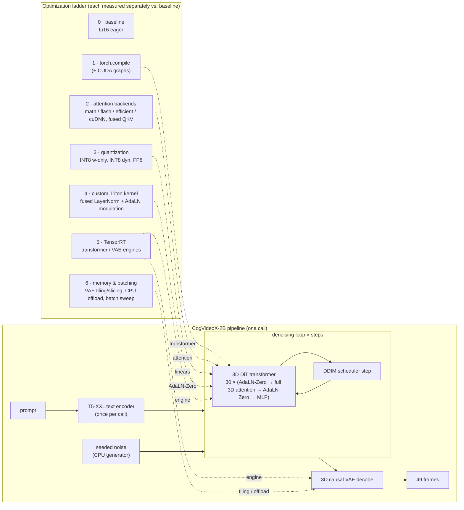
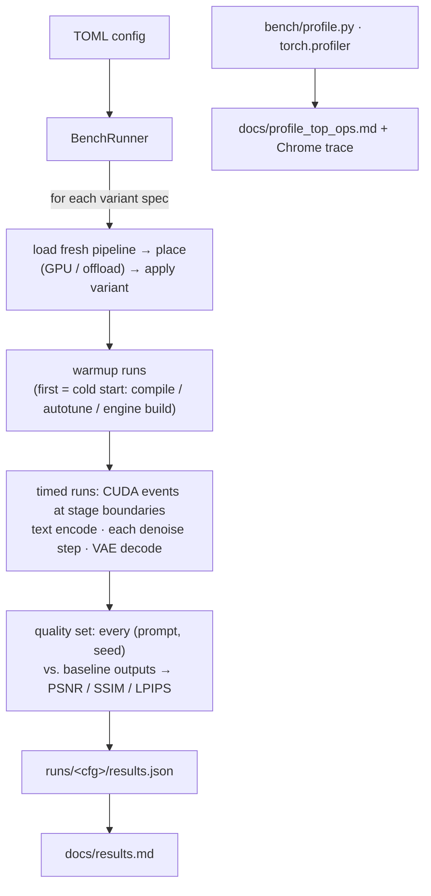

# FrameFast

FrameFast is an inference-optimization ladder and benchmark harness for an open-source text-to-video
diffusion model, **CogVideoX-2B**, served through Hugging Face `diffusers`. Each optimization is a
separate variant, and each variant is measured against an **fp16 PyTorch eager baseline**: latency
(p50/p95), throughput, peak memory, a per-stage breakdown, and output quality (PSNR / SSIM / LPIPS)
on a fixed prompt set with fixed seeds.

> **Status: NOT YET MEASURED ON GPU.** All code, tests and the harness exist and run on CPU. No GPU
> timings exist yet, and this README makes no speedup claims. The only place performance numbers
> will appear is [`docs/results.md`](docs/results.md), and the harness writes that file. For now it
> is a placeholder that says *NOT YET MEASURED ON GPU*. To fill it, see
> [Running on a GPU](#running-on-a-gpu).

---

## Contents

- [Model choice](#model-choice)
- [Architecture and the ladder](#architecture-and-the-ladder)
- [Where the time goes: roofline reasoning](#where-the-time-goes-roofline-reasoning)
- [The optimizations](#the-optimizations)
- [Benchmark methodology](#benchmark-methodology)
- [Running on a GPU](#running-on-a-gpu)
- [What is verified on CPU vs. what needs a GPU](#what-is-verified-on-cpu-vs-what-needs-a-gpu)
- [Honest limitations](#honest-limitations)
- [Repository layout](#repository-layout)

## Model choice

**`THUDM/CogVideoX-2b`** is the default (`configs/*.toml`). Reasons:

| Criterion | CogVideoX-2B |
|---|---|
| Size | The smallest CogVideoX checkpoint: a ~2B-parameter 3D DiT (30 blocks, hidden 1920 = 30 heads × 64), a T5-XXL text encoder (runs once per call), and a 3D causal VAE. |
| Baseline dtype | The model card recommends **fp16** for the 2B checkpoint (the 5B uses bf16), so the required "fp16 eager" baseline is the model's native precision and not a downcast. |
| Library support | First-class `diffusers` pipeline with VAE tiling/slicing, CPU offload, `fuse_qkv_projections`, and documented torchao / `torch.compile` paths. Every rung of the ladder can use maintained APIs. |
| Workload shape | Native output is 49 frames × 480×720, which is **17,550 video tokens + 226 text tokens in one full-3D attention**. That is long enough that attention, GEMMs and memory-bound element-wise ops all matter, which makes it a good teaching case for the roofline arguments below. |
| License | Apache-2.0 for the 2B weights. |

Alternatives considered:
- **Wan2.1-T2V-1.3B** has a smaller DiT, but it is bf16-native and uses a larger UMT5-XXL encoder.
- **LTX-Video** is fast, but its checkpoints and pipeline variants have changed often.

The harness is model-agnostic up to the variant code (any `diffusers` pipeline with `encode_prompt`,
`vae.decode` and `callback_on_step_end` can be timed). The Triton patch and the TensorRT shim are
specific to the CogVideoX module classes.

## Architecture and the ladder





Variants are named in a registry (`framefast/variants.py`) and can be stacked with `+`, for example
`compile+int8_wo` or `vae_slicing+bs2`. `torch.compile` is always applied last within a stack, so
the module rewrites (quantization, kernel patches) are traced. A variant that cannot run on the
current machine is reported as **skipped** with a reason. Examples: FP8 on a pre-Ada GPU,
`torch_tensorrt` not installed. A variant that crashes (OOM, export error) is reported as
**failed** with the error. Neither stops the ladder.

## Where the time goes: roofline reasoning

The numbers in this section are **back-of-the-envelope arithmetic** from the model config. They are
not measurements; the measured breakdown comes from `make profile` → `docs/profile_top_ops.md`.
At the native shape with CFG, the transformer sees a batch of 2 and M = 2 × 17,776 ≈ 35.5k
tokens per call, with D = 1920:

| Op family (per block, per step) | Arithmetic intensity | Regime |
|---|---|---|
| Linear layers (QKV, out-proj, 2-layer MLP with 4× expansion): ≈ 24·D²·M ≈ 3.2 TFLOP | ≈ 900 FLOP/byte for a 35.5k×1920×1920 fp16 GEMM | **compute-bound**. A100 (≈312 TFLOP/s ÷ ≈2 TB/s) and H100 (≈990 ÷ ≈3.35) ridge points are ~150–300 FLOP/B. |
| Full 3D attention: 4·N²·d_head·heads·batch ≈ 4.9 TFLOP | flash-style kernels have high intensity; the naive "math" path materializes **N² × heads × batch ≈ 1.9·10¹⁰ scores ≈ 38 GB in fp16** | Compute-bound if fused. With the naive path, memory capacity and bandwidth dominate. |
| LayerNorm + `·(1+scale) + shift` (AdaLN-Zero), residual gates, GELU | ≈ 1–3 FLOP/byte | **memory-bound**: time ≈ bytes ÷ HBM bandwidth |

What follows from these estimates:
- **Attention is probably the biggest single FLOP consumer** at this sequence length: about 60% of
  block FLOPs by the arithmetic above. That makes attention backends (rung 2) and low-precision
  attention the levers with the most headroom. It also means **the `attn_math` variant is expected
  to fail with OOM at native resolution**, because its score matrix alone is about 38 GB. That
  failure is the result: it shows why fused attention is mandatory and not optional.
- **The GEMMs are compute-bound.** fp16→int8 *weight-only* quantization mainly saves weight memory.
  Speeding them up needs the int8/fp8 *tensor cores*, which means dynamic-activation quantization
  (`int8_dyn`, `fp8_dyn`).
- **The element-wise and normalization ops are memory-bound.** Their cost is the number of HBM
  passes, so fusion (rung 1's inductor, or rung 4's hand-written kernel) is the lever, not FLOPs.
- **Launch overhead.** Each step launches several hundred kernels that run for milliseconds each, so
  CPU launch overhead is plausibly a small share. CUDA graphs (`compile_cudagraphs`) test exactly
  that.

## The optimizations

| Rung | Variant(s) | What it does | Why it should help | Trade-offs |
|---|---|---|---|---|
| 0 | `baseline` | fp16 eager `diffusers` pipeline with default SDPA dispatch (`F.scaled_dot_product_attention` picks a fused backend automatically) | reference | — |
| 1 | `compile` | `torch.compile(transformer, mode="max-autotune-no-cudagraphs")` with the inductor settings the PyTorch team recommends for DiTs | Fuses memory-bound element-wise/norm chains into fewer kernels, autotunes GEMM tiles, removes Python overhead | Compilation time (reported as **cold start**), recompiles if shapes change |
| 1 | `compile_cudagraphs` | `mode="max-autotune"` (inductor CUDA graph trees) | Replays the whole step with one launch, removing CPU launch latency | Static shapes and addresses, extra memory for graph pools, incompatible with CPU offload |
| 2 | `attn_math` | forces the SDPA **math** backend (explicit `QKᵀ`, softmax, `·V`) | Unfused reference that shows the cost of materializing N² scores | Expected OOM at native shape (see above) |
| 2 | `attn_flash`, `attn_efficient`, `attn_cudnn` | forces one SDPA backend each (FlashAttention-2, memory-efficient, cuDNN) | Tiled online-softmax attention: O(N) memory, scores never leave SRAM | Backend availability depends on GPU, dtype and head dim; failures are recorded |
| 2 | `fuse_qkv` | `pipe.fuse_qkv_projections()` | One `D×3D` GEMM instead of three `D×D`: better tile utilization, one read of the activations | Small extra memory during fusion |
| 3 | `int8_wo` (+`compile+int8_wo`) | torchao INT8 weight-only on all transformer linears | Halves linear weight bytes; helps memory-bound small-M matmuls; needs `compile` to fuse the dequantize into the GEMM | Little gain for compute-bound GEMMs; small accuracy loss |
| 3 | `int8_dyn` | torchao INT8 dynamic activation + INT8 weight | INT8 tensor-core GEMMs (higher peak throughput than fp16) | Per-token activation quantization error; quantize/dequantize overhead |
| 3 | `fp8_wo`, `fp8_dyn` (+`compile+fp8_dyn`) | torchao FP8 e4m3 (weight-only / dynamic per-row) | FP8 tensor cores on Ada/Hopper; better dynamic range than INT8 | Needs compute capability ≥ 8.9, otherwise skipped |
| 3 | `int8_wo_ref` | FrameFast's pure-PyTorch per-channel INT8 weight-only linear (`framefast/quant.py`) | Unit-testable on CPU; the same scheme as torchao int8 weight-only | Eager dequant each call: saves memory, **not expected to be faster** |
| 4 | `triton_adaln` (+`compile+triton_adaln`) | Hand-written Triton kernel fusing `LayerNorm → ·(1+scale) → +shift` in every `CogVideoXLayerNormZero` (2 per block × 30 blocks, each normalizing video and text tokens) | Memory-bound chain. Eager uses 3 kernels, about 6 activation passes through HBM. The fused kernel uses 2 (read `x`, write `y`) and accumulates statistics in fp32. | Inference only (no backward). Under `torch.compile`, inductor already fuses this chain, so `compile+triton_adaln` vs `compile` tests whether the hand-written kernel beats inductor's codegen. It is registered as a `torch.library.triton_op`, so it composes with compile without a graph break. |
| 5 | `trt_transformer` | `torch.export` → Torch-TensorRT engine for the transformer at the run's static shapes, swapped in through a shim | TensorRT kernel selection, layer fusion and engine-level planning | Engine build time (cold start), one engine per resolution/batch, unsupported ops fall back to PyTorch (fallback subgraphs are counted in the notes) |
| 5 | `trt_vae` | the same for `vae.decode` | Conv3d-heavy decoder; TensorRT's conv tactics | See limitations: unverified on GPU, potentially large engine and workspace |
| 6 | `vae_tiling`, `vae_slicing` | `vae.enable_tiling()` / `enable_slicing()` | Lower **peak memory** of the VAE decode, which can let larger batches fit | Tiling adds overlap compute and can show seams; slicing only matters for batch > 1 |
| 6 | `cpu_offload_model`, `cpu_offload_seq` | `enable_model_cpu_offload` / `enable_sequential_cpu_offload` | Fits the model on small GPUs | Much slower: PCIe transfers on every call or layer. Sequential offload is capped at 2 timed runs. |
| 6 | `bs2`, `bs4`, … (`bs<N>`) | N videos per call (prompt list) | Larger M per GEMM, better utilization: compare on **frames/s** | Latency per call rises; memory |

### Why this kernel for rung 4

`CogVideoXLayerNormZero` runs twice per block, on both the video and the text tokens. Each call is a
`native_layer_norm` followed by a broadcast `mul` and a broadcast `add` over the full
`(2, 17550, 1920)` activation, about 135 MB per pass in fp16. Eager makes about 6 such passes; the
fused kernel makes 2. That makes it the clearest **memory-bound, fusible, self-contained** hot op
in the block. It needs no change to the weights or numerics, and its correctness can be tested
exactly. `make profile` produces the evidence for or against this choice: the module-level table
reports the share of transformer GPU time inside `CogVideoXLayerNormZero`, and the category table
reports the share in normalization and element-wise ops. If that share turns out small on your GPU,
expect the kernel's end-to-end effect to be small too. Report that honestly; it would still be a
correct result. The kernel choice was made from this analysis *before* GPU profiling was possible.
Treat it as a hypothesis that the profile confirms or rejects.

## Benchmark methodology

- **Isolation.** Every variant loads a fresh pipeline. Nothing compiled or quantized leaks into the
  next variant (`torch._dynamo.reset()` and `empty_cache()` run in between). The baseline always
  runs first.
- **Timing.** `torch.cuda.Event(enable_timing=True)` marks are recorded at the stage boundaries:
  start/end of `pipe.encode_prompt`, the `callback_on_step_end` of every denoising step, and
  start/end of `vae.decode`. Nothing synchronizes until the call has finished, so measurement does
  not perturb the async launch queue. Results: p50/p95, mean/std/min/max over `runs` timed calls,
  per-stage medians, median per-step latency, and frames/s = frames × batch ÷ p50.
- **Warmup.** `warmup` untimed calls run first. The wall-clock time of the first call is reported
  as **cold start**: compile, autotune or TRT build.
- **Peak memory.** `torch.cuda.max_memory_allocated()` (and reserved) during the timed runs. Stats
  are reset after warmup so autotuning scratch is excluded; the weights stay counted.
- **Quality.** The latent noise comes from a **CPU** `torch.Generator`, so it is bit-identical across
  devices and variants. Every `(prompt, seed)` pair in the config is generated by each variant and
  compared with the baseline's video for the same pair: PSNR (dB), SSIM (Gaussian 11×11, matches
  scikit-image) and LPIPS (AlexNet, if the `lpips` package and weights are available). The
  baseline row compares the baseline against a **second baseline run**, which gives the
  run-to-run noise floor. Diffusion sampling is iterative, so a tiny numerical change, such as a
  different GEMM reduction order under compile, can grow into a visibly different but equally
  plausible video. Read PSNR/SSIM together with LPIPS and with the saved videos
  (`save_videos = true`).
- **Defaults.** `configs/gpu_default.toml` uses native 49×480×720 at 20 steps (instead of the
  default 50) with 2 warmup and 8 timed runs, so the whole ladder finishes in reasonable time. A
  50-step latency can be read off as text + 50 × per-step + VAE. `configs/gpu_full.toml` runs
  50 steps × 10 runs × (3 prompts × 2 seeds). With few runs, p95 approaches the max; the report
  says so.
- **For lower variance** (optional): lock the GPU clocks (`sudo nvidia-smi -lgc <max>`), close other
  GPU processes, and run each config twice.

## Running on a GPU

### Option A: Google Colab
Open [`notebooks/FrameFast_colab.ipynb`](notebooks/FrameFast_colab.ipynb) in Colab, select a GPU
runtime (A100 recommended; FP8 needs L4/H100-class, compute capability ≥ 8.9), and run all cells.
It clones this branch, runs `scripts/run_on_gpu.sh` and renders the reports.

### Option B: Lambda / any Linux + NVIDIA GPU
```bash
git clone -b claude/framefast-inference-optimization-n0vu0b https://github.com/WenxueWu0216/FrameFast.git
cd FrameFast
python3 -m venv .venv && source .venv/bin/activate      # optional

# Everything in one command: install, unit tests (incl. GPU kernel tests), profile, full ladder.
bash scripts/run_on_gpu.sh

# Add the TensorRT rung (torch-tensorrt pins a torch version and may reinstall torch):
FRAMEFAST_TRT=1 bash scripts/run_on_gpu.sh

# Quick sanity pass first (minutes, short ladder, writes runs/gpu_quick/results.md):
CONFIG=configs/gpu_quick.toml bash scripts/run_on_gpu.sh
```

Or step by step:
```bash
make install-gpu            # pip install -e ".[dev,gpu]"
make test                   # CPU + GPU tests (GPU tests auto-enable when CUDA is present)
make profile                # -> docs/profile_top_ops.md (+ runs/profile/trace.json)
make bench                  # full ladder -> docs/results.md, runs/gpu_default/results.json
make bench CONFIG=configs/gpu_full.toml
python -m bench.run_bench --config configs/gpu_default.toml --variants baseline,compile,attn_flash
```
The first run downloads the CogVideoX-2B weights from the Hugging Face Hub. The checkpoint should not
need a token; if the Hub asks for one, run `huggingface-cli login`. Commit the generated `docs/results.md` and
`docs/profile_top_ops.md`; they are the only source of performance claims for this project.

## What is verified on CPU vs. what needs a GPU

Everything below runs in CI (GitHub Actions, CPU only) and locally with `make test` and
`make bench-cpu-smoke`.

**Verified on CPU**
- **Triton kernel numerics.** The *same* `@triton.jit` kernel runs under the Triton interpreter
  (`TRITON_INTERPRET=1`) against the PyTorch reference, covering fp32, affine/no-affine,
  non-power-of-two D, strided `chunk()` modulation views, and non-contiguous token slices. A patched
  tiny CogVideoX transformer matches the unpatched one, and unpatching restores it bit-exactly.
- **Quantization.** Per-channel INT8 round-trip error ≤ ½ step. The INT8 linear matches the fp
  linear (relative error < 1%). A quantized tiny transformer stays within 5% relative error and
  uses fewer bytes. torchao `int8_wo` also runs on CPU.
- **Export path.** Transformer input capture; positional-embedding pinning, which is
  output-preserving and idempotent. `torch.export` of the transformer **fails without pinning and
  succeeds with it**, at the tiny model's non-native resolution. `torch.export` of `vae.decode`
  succeeds. The pipeline shim running the exported program reproduces the eager pipeline and
  rejects other shapes.
- **Metrics.** Percentiles match NumPy, SSIM matches scikit-image, and PSNR is checked on known
  values.
- **Harness.** The stage timer splits a real pipeline call into text/denoise/VAE/other. The
  runner, skip/fail handling and report generation all run. A CPU report never shows a speedup.
  `make bench-cpu-smoke` runs the tiny random-weight model through baseline, `compile`, attention,
  quantization, Triton (interpreter), stacked variants, VAE and batch variants, plus the
  profiler.

**Must be verified on a GPU** (code exists but has not been run here)
- Every latency, throughput and peak-memory number, and every speedup.
- The compiled Triton kernel (`test_cuda_*` in `tests/test_triton_adaln.py`, fp16/bf16 at real
  CogVideoX shapes, `torch.compile` interop through `triton_op`) and its end-to-end effect.
- `compile_cudagraphs`, the flash/efficient/cuDNN SDPA backends, torchao INT8/FP8 on CUDA, and FP8
  capability gating.
- The Torch-TensorRT build of the transformer and the VAE: engine/fallback partition counts, build
  time and correctness. `tests/test_export.py::test_trt_transformer_end_to_end_cuda` covers it.
- CPU-offload variants, real-model quality metrics (LPIPS included), and OOM behavior at native
  shape (`attn_math`, large batches).

## Honest limitations

- **No GPU numbers yet.** The roofline section is arithmetic, not measurement. The hypothesis that
  attention dominates and the choice of the Triton target both wait on `make profile`.
- **Triton kernel scope.** Forward only, one row per program, `BLOCK_D = next_pow2(D)` (2048 for
  D = 1920), no autotuning yet. Under `torch.compile`, inductor already fuses the same chain, so a
  win over `compile` is not expected a priori. On CPU the kernel runs in the interpreter, so its
  CPU-smoke latency is meaningless (the report says so).
- **TensorRT.** Engines use static shapes, one per resolution/batch. The diffusers cache hooks
  (`cache_context`) become no-ops through the shim. The text encoder is **not exported**: it runs
  once per call, and the per-stage table shows its share. TRT and CPU offload are mutually
  exclusive. The transformer's `torch.export` needs the positional embedding pinned, because at
  non-native resolutions diffusers rebuilds the embedding with NumPy inside `forward`. FrameFast
  precomputes it (verified on CPU). `trt_vae` is the least certain rung: the CogVideoX decoder loops
  over frame chunks with a causal conv cache, which `torch.export` unrolls into one large static
  graph (verified on the tiny model). Engine size and build workspace at 49×480×720 are unknown
  until it is tried. If it fails, the failure and its reason land in `docs/results.md`.
- **FP8** requires compute capability ≥ 8.9 and is skipped on A100/T4. torchao API names change
  between releases. The code supports the config-object API (≥ 0.9) and the older function API,
  but not every torchao version.
- **Quality metrics are relative to the fp16 baseline**, not to ground truth, and pixel metrics
  penalize benign trajectory divergence (see methodology).
- **Measurement scope.** Single GPU, single process, batch sweep up to what fits. No
  multi-GPU/context-parallel attention, no caching or step-skipping methods (e.g. TeaCache,
  PAB), and no step distillation, although these are often the biggest real-world wins.

## Repository layout

```
framefast/
  config.py        BenchConfig (TOML), default prompts and ladder
  pipeline.py      CogVideoX-2B loader + tiny offline random-weight CogVideoX (tests/CI)
  timing.py        CUDA-event per-stage timer (text / each step / VAE / other)
  stats.py         p50/p95 etc.
  quality.py       PSNR, SSIM, LPIPS, aggregation
  variants.py      the ladder: registry, stacking with '+', skip checks
  runner.py        fresh-pipeline-per-variant benchmark loop, results.json
  report.py        results.json -> docs/results.md (NOT YET MEASURED ON GPU banner)
  quant.py         torchao schemes + reference INT8 weight-only linear
  trt.py           input capture, pos-embedding pinning, torch.export probes, Torch-TensorRT shim
  kernels/adaln.py Triton fused LayerNorm + AdaLN modulation, reference, CogVideoX patcher
bench/
  run_bench.py     `make bench` / `make bench-cpu-smoke` entry point
  profile.py       torch.profiler module/category/top-op tables + Chrome trace
configs/           gpu_default / gpu_quick / gpu_full / cpu_smoke
scripts/run_on_gpu.sh, notebooks/FrameFast_colab.ipynb
docs/results.md, docs/profile_top_ops.md   (generated; placeholders until run on a GPU)
tests/             CPU tests (+ skip-if-no-CUDA GPU tests)
```

Development: `make install && make lint test bench-cpu-smoke`.
